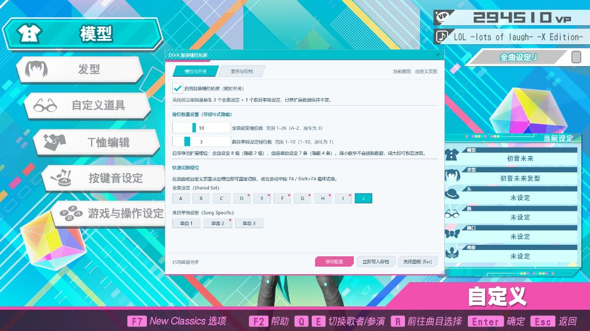

# DivaExtraModuleSets

English · [简体中文](README.md)

An outfit slot expansion mod for *Hatsune Miku: Project DIVA Mega Mix+* (PC Steam 1.03 / DivaModLoader): expands **Shared Sets up to A–Z (26)** and **Song Specific sets up to 1–10 (10)** with native hotkey cycling, an in-game control panel, and zero impact on vanilla saves.

## Install

1. Install [DivaModLoader](https://github.com/blueskythlikesclouds/DivaModLoader).
2. Exit the game, download the archive from [Releases](https://github.com/HYDlink/DivaExtraModuleSets/releases/latest), and extract `DivaExtraModuleSets` into `mods/`.
3. Enable the mod in your mod manager.

## Controls

- **`F4` / `Shift + F4`**: Cycle outfit slots forward / backward in Song Select, PV Playlist Edit, and Customization
- **`F8`**: Toggle the in-game control panel (adjust slot counts, click to jump directly, toggle expansion live)

## Docs

- [Usage, Configuration & Building from Source](docs/USAGE.en.md)
- [Architecture & Engineering Lessons (Chinese)](docs/ARCHITECTURE_AND_LESSONS.md)
- [Live Reverse-Engineering Trace (Chinese)](docs/LIVE_REVERSE_TRACE.md)

Licensed under **GNU AGPL-3.0-or-later**. See [LICENSE](LICENSE) and [THIRD_PARTY_NOTICES.md](THIRD_PARTY_NOTICES.md).
