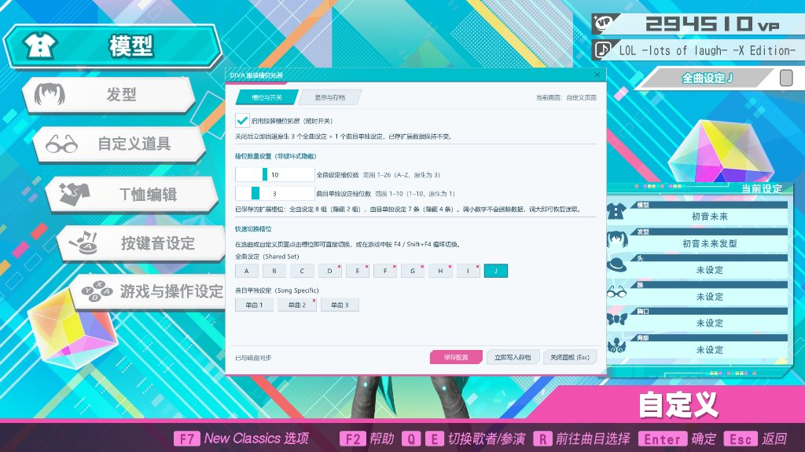

# DivaExtraModuleSets

[English](README.en.md) · 简体中文

《初音未来 Project DIVA Mega Mix+》（PC Steam 1.03 / DivaModLoader）服装槽位拓展 Mod：将全曲设定扩展至 **A–Z（最多 26 套）**、曲目单独设定扩展至 **1–10（最多 10 套）**，支持原生按键循环切换与游戏内控制面板，原生存档零改动。

## 安装

1. 安装 [DivaModLoader](https://github.com/blueskythlikesclouds/DivaModLoader)。
2. 退出游戏，从 [Releases](https://github.com/HYDlink/DivaExtraModuleSets/releases/latest) 下载压缩包，将 `DivaExtraModuleSets` 文件夹解压至 `mods/`。
3. 在 Mod 管理器中启用即可。

## 按键

- **`F4` / `Shift + F4`**：在选曲、播放列表编辑与自定义换装页正/反向切换套装槽位
- **`F8`**：打开 / 关闭游戏内控制面板（调槽位数、点选直达、随时开关拓展）

## 更多文档

- [使用、配置与源码构建说明](docs/USAGE.md)
- [架构原理与实机踩坑总结](docs/ARCHITECTURE_AND_LESSONS.md)
- [实机逆向追踪记录](docs/LIVE_REVERSE_TRACE.md)

基于 **GNU AGPL-3.0-or-later** 开源，详见 [LICENSE](LICENSE) 与 [THIRD_PARTY_NOTICES.md](THIRD_PARTY_NOTICES.md)。
